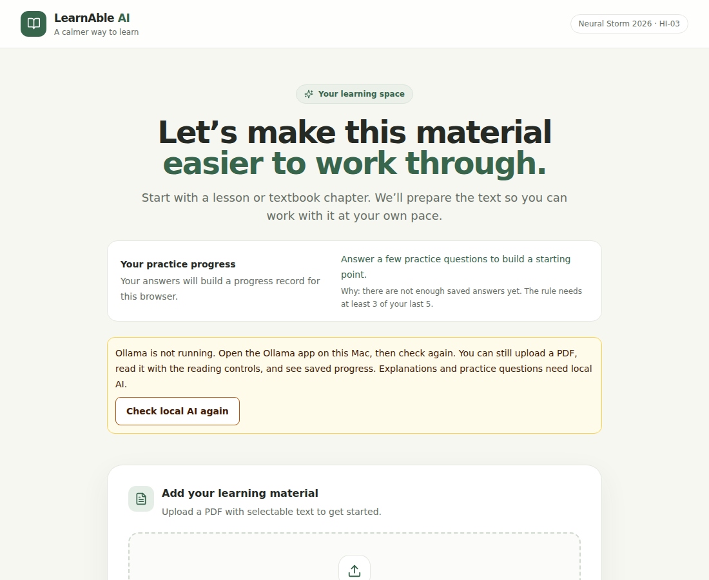
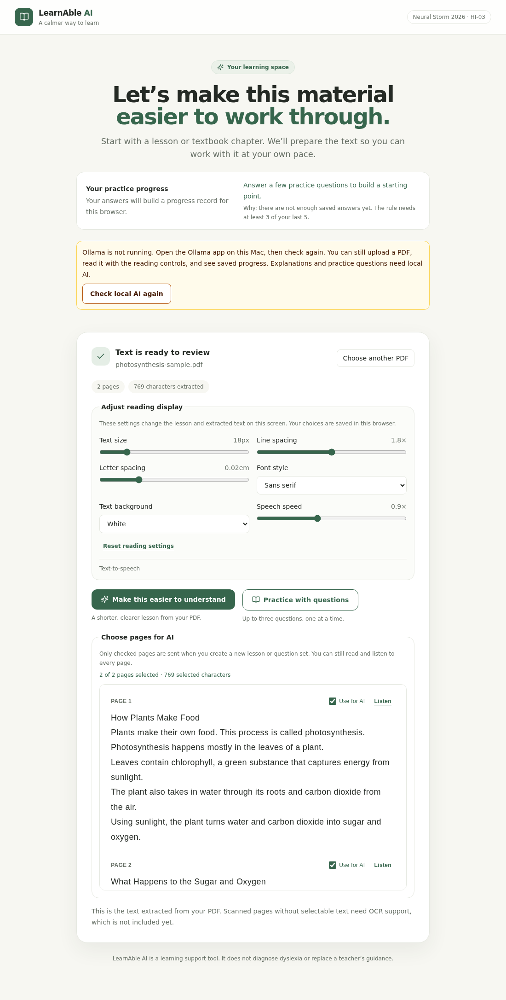

# LearnAble AI

**Neural Storm 2026 · HI-03: Adaptive Learning for Students with Disabilities** · solo, 48-hour project

LearnAble AI helps a student read a hard PDF by turning selected pages into short, plain-language explanations, letting them **check each explanation against the original page**, and then practising with comprehension questions that adjust to their recent answers. Its first focus is reading support for students with dyslexia. All AI runs **locally on the user's Mac through Ollama**. No cloud model, API key, account, or telemetry is used.

> LearnAble AI is a study-support tool. It does **not** diagnose dyslexia or any other condition, and no claim is made that it improves learning outcomes. That would need a real study with learners, which has not been done.

## The problem and learner need

Students with dyslexia often get dense textbook pages that are hard to decode and hard to check their understanding of. Generic "summarise this" tools make that worse in two ways: they can state things the page does not say, and the student cannot tell. LearnAble AI addresses this specific need:

- **Easier text:** short sentences, defined key words, adjustable size, spacing, font, background, and read-aloud (browser text-to-speech).
- **Checkable answers:** every section, term, and question links to the PDF page and shows the closest passage on that page, so the learner (or a teacher) can verify instead of trusting.
- **Fair practice that adapts:** up to three questions per set; the next set's style changes from recent saved answers, and the app says *why*.

## Screenshots (real captures from the running app)

| | |
| --- | --- |
|  |  |
| Ollama stopped: the app says so, explains what still works, and offers a re-check. | A sample PDF after upload: reading controls and per-page "Use for AI" selection. |

These were taken with Ollama **not running**, so they show the offline state, not a generated lesson. Screenshots of a generated lesson and questions have not been captured yet; add them after your own run (see the demo checklist).

## How it works

```
React + TypeScript + Tailwind  ──HTTP──▶  FastAPI  ──▶ PyMuPDF (PDF text, in memory only)
        (browser)                            │──▶ SQLite (answers + adaptation history)
                                             │──▶ Adaptive rule (adaptive_engine.py)
                                             └──▶ Ollama on 127.0.0.1:11434 (qwen3.5:4b, JSON-schema output)
```

1. **Upload:** PyMuPDF extracts selectable text page by page. The file is never written to disk.
2. **Select pages:** only checked pages are sent to the local model (limit 50,000 characters).
3. **Explain:** the model returns a lesson in a fixed JSON schema, naming the pages it used.
4. **Evidence:** the backend finds the sentence on each cited page that shares the most important words with the generated text, confirms it really appears on that page, and shows it with the shared words. *For questions, only the question, correct answer, and explanation are matched; wrong choices are ignored.*
5. **Practice and adapt:** the learner answers one question at a time. A transparent rule over the last five saved answers picks the next style: fewer than 3 answers → steady; under 50% correct → shorter one-idea questions; 80% or more → gentle connecting questions; otherwise steady. The UI shows the numbers behind the choice.

The "adaptive algorithm" is this explicit rule, not a trained model. It was chosen so a learner or teacher can see exactly why the next set changed.

## What works without Ollama, and what needs it

| Works with Ollama stopped | Needs Ollama running with the model installed |
| --- | --- |
| PDF upload and text extraction | Simplified explanations |
| Page selection, reading controls, read-aloud | Practice question generation |
| Saved progress and adaptive recommendation with its reason | |
| Clear status banner and re-check button | |

The status banner calls `GET /api/health/ollama`. Behaviour with Ollama stopped was checked by running the backend with no Ollama present (extraction, progress, and the status endpoint responded; generation returned a clear message).

## Set up and run on a Mac

Requirements: Python 3.13, Node.js 22.12+ (or 24/26), about 4 GB of free disk for the model. Model speed and quality depend on your Mac's memory and chip.

**1. Install Ollama and the model**

Download Ollama from [ollama.com/download/mac](https://ollama.com/download/mac) and open the app (it serves `127.0.0.1:11434`). Then:

```bash
ollama pull qwen3.5:4b
ollama list            # confirm qwen3.5:4b is listed
```

**2. Start the backend** (Terminal 1)

```bash
cd /Users/revanth/Documents/learnable-ai
cp .env.example .env   # only sets OLLAMA_MODEL; there are no secrets
cd backend
python3.13 -m venv .venv
source .venv/bin/activate
python -m pip install -r requirements.txt
uvicorn app.main:app --reload
```

**3. Start the frontend** (Terminal 2)

```bash
cd /Users/revanth/Documents/learnable-ai/frontend
npm ci
npm run dev
```

Open <http://localhost:5173>. A sample PDF is included at `samples/photosynthesis-sample.pdf` (original text written for this project).

Progress is stored in `backend/data/learnable.sqlite3` under a random browser ID (no names or accounts). Anyone sharing the same browser profile shares that record.

### There is no hosted demo link

A cloud-hosted backend cannot reach Ollama running only on this Mac, and this project deliberately has no remote-inference option. Use the local setup above or the recorded video. Details: [docs/deployment.md](docs/deployment.md).

## Privacy

- Inference goes only to `http://127.0.0.1:11434`. The URL is fixed in code, proxy environment variables are ignored for these calls, and `:cloud` model tags are rejected.
- PDF files and extracted text are not saved. SQLite stores generated questions, answer options, explanations, page numbers, and attempts. It does **not** store verbatim PDF excerpts (older databases are cleaned of them on next open). Generated questions are model-written text derived from your PDF, so treat the database file as private.

## Tests and checks

Commands:

```bash
cd backend && source .venv/bin/activate && python -m pip install -r requirements-dev.txt && python -m pytest
cd ../frontend && npm test && npm run build
```

Results from the last run, in a Linux sandbox with Python 3.12.3 and Node 22.22.2 (not the Python 3.13 target; re-run on your Mac):

| Check | Result |
| --- | --- |
| Backend tests (`pytest`) | 56 passed |
| Frontend tests (`vitest`, including axe-core DOM checks) | 16 passed |
| Frontend production build (`tsc -b && vite build`) | succeeded |
| Backend run without Ollama + `scripts/smoke_test.py` | backend reachable, PDF extraction passed; exit code 2 ("local AI not ready") as designed |
| Smoke test **with** real Ollama | **Not run yet.** Run `python scripts/smoke_test.py` with the backend and Ollama running. |

All model calls in the automated tests use fake responses, so these tests check the application logic, **not the quality or accuracy of the model**. The smoke test, when you run it, checks that the pipeline returns well-formed output and that quotes appear on their cited pages. It does not judge whether explanations or questions are correct, and its timings come from one run on one machine. No model-accuracy evaluation has been done.

Automated accessibility checks cannot replace a screen reader. Use [docs/accessibility-checklist.md](docs/accessibility-checklist.md) for a manual keyboard and VoiceOver pass; that pass has not been recorded.

## Known limitations

- **Evidence is not proof.** The shown passage is real text from the cited page, found by word matching. It can share words with a claim yet not support it (a test documents such a case). The UI labels matches as "several shared words" or "few shared words" and tells learners to read the page. It never says "verified".
- The explanation and questions come from a 4B-parameter local model and can be wrong, awkward, or incomplete. Questions have not been reviewed by educators.
- A weak keyword match with no shared words fails the request rather than showing an unrelated quote; you may need to retry.
- The adaptive rule uses only recent right/wrong counts. It does not measure reading ability, attention, or learning gains, and its thresholds are not validated.
- No OCR: scanned or image-only PDFs are rejected. Maximum 10 MB, 100 pages, 50,000 characters per request.
- English text only has been considered. Text-to-speech depends on the browser's voices.
- No user research or classroom testing has been done. Reading-display defaults are not shown to help any particular learner.
- The anonymous browser ID is not account security.
- The repository root contains `Electricity_Consumption_Weather_MATLAB_Mini_Project.pdf`, which is unrelated to this project. It is git-ignored; remove it if you do not need it.

## Demo script (about 3 minutes)

1. **Problem (20 s):** "Dense PDFs are hard for students with dyslexia, and AI summaries can't be trusted blindly. This tool makes text easier *and* checkable, all locally."
2. **Start state (15 s):** show the green "Local AI is ready" line. Optionally stop Ollama to show the banner and that PDF upload still works, then restart it.
3. **Upload** `samples/photosynthesis-sample.pdf`; change text size, spacing, background; press Listen on a page.
4. **Explain (45 s):** click *Make this easier to understand*. Note the elapsed-seconds message while the local model works.
5. **Check the evidence (30 s):** open *Show closest passage in the PDF*; point out the shared words and the "may not prove the point" note; follow the page link.
6. **Practice (45 s):** answer three questions; show the feedback and the "Why:" line explaining the next set.
7. **Honest limits (20 s):** state that it is not a diagnosis tool, the model can be wrong, and no learning-outcome study has been done.

## Backup demo video checklist

- [ ] Ollama running, `ollama list` shows `qwen3.5:4b`, and the model has been warmed up with one earlier generation (the first run is slower).
- [ ] Backend and frontend running; `python scripts/smoke_test.py` passes first.
- [ ] Fresh browser profile or cleared local storage so progress starts at zero; close notifications.
- [ ] Record the full flow in one take, including the real wait for generation (do not splice in fake results).
- [ ] Show the evidence panel and the "Why:" adaptation line on screen long enough to read.
- [ ] Capture screenshots of the generated lesson, evidence panel, and a question for this README.
- [ ] Say what was measured and what was not (see Tests and checks).
- [ ] Save the video locally and keep a copy off the machine.

## Project layout

```text
frontend/src/           React UI, API client, EvidenceList, tests
backend/app/main.py     FastAPI routes
backend/app/services/   PDF extraction, Ollama client, lesson/question generation, evidence, adaptive rule
backend/app/db/         SQLite persistence
backend/tests/          API, service, reliability and privacy tests
samples/                Original sample PDF; scripts/ builds it and runs the smoke test
docs/                   Architecture, deployment note, accessibility checklist, screenshots
```

---

## Team Details

- Participation Type: Individual
- Participant Name: Revanth Panvi
- Team Size: 1

## AI Development Tools Disclosure

The following AI development tool was used during the development of this project:

- **Claude (Anthropic):** Used as an AI-assisted development tool.

AI assistance was used during the project development process. The resulting implementation was integrated into the project by the participant.

